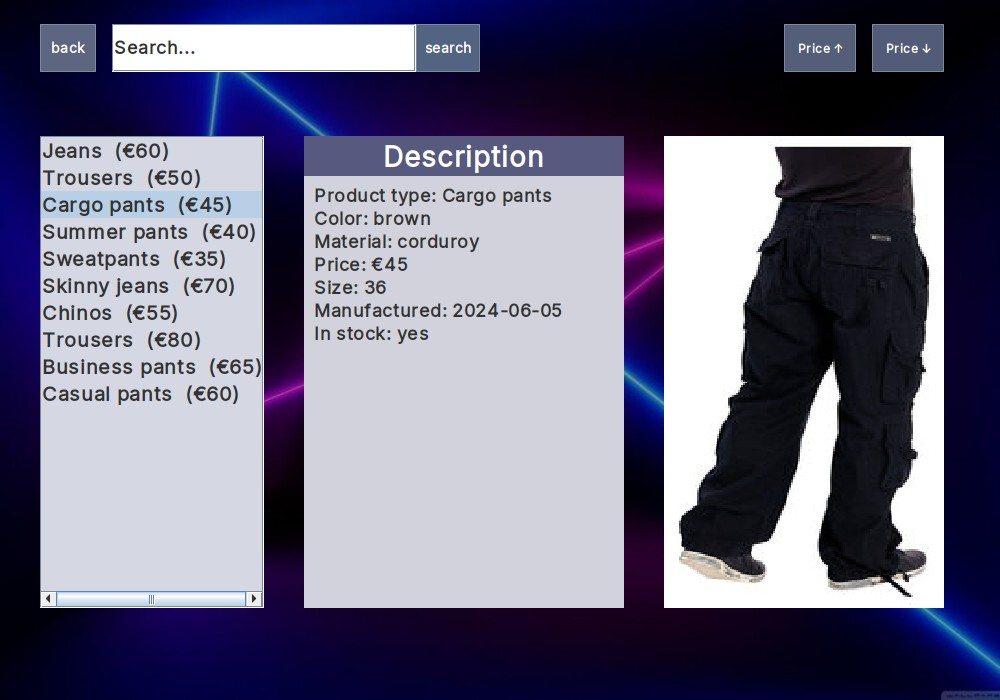
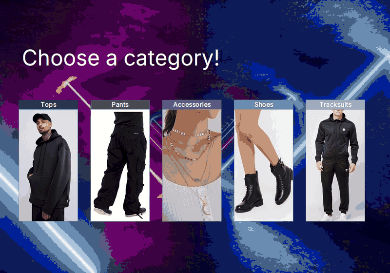
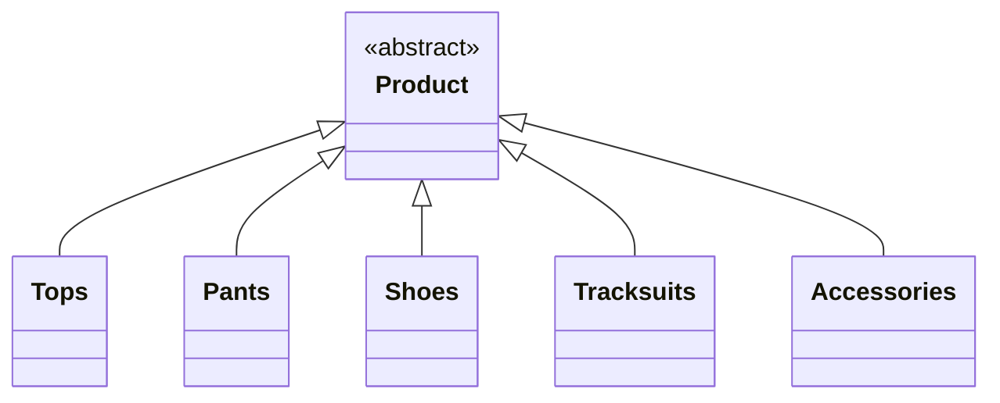

<div align="center">

# Shamishop · Fashion Shop in Java

A desktop fashion shop app built with Java Swing.




</div>

I originally wrote it for a computer science course at school and later refactored it and translated it into English.

## Features

- Welcome screen with a loading bar and a category overview (tops, pants, shoes, tracksuits, accessories)
- Product list per category with images and descriptions
- Search by product type, color or material (press Enter or click search)
- Sort by price, ascending and descending
- Product details with a matching picture for every category
- Custom background images

## A quick tour

Choosing a category, opening a product, sorting by price and searching for "black":



## Quick start

You need a JDK (tested with Java 21) and a desktop environment, since this is a GUI app.

```bash
git clone https://github.com/meuselina/Shop-coded-with-Java.git
cd Shop-coded-with-Java

javac -encoding UTF-8 *.java
java WelcomeFrame
```

The image files need to be in the same folder as the program, so start it from the project folder.

## Architecture

All product types share one abstract base class. Each category only adds what makes it different.



| File | Purpose |
|---|---|
| `WelcomeFrame.java` | Welcome screen and entry point |
| `CategoryFrame.java` | Category selection |
| `ShopFrame.java` | Main shop window: list, search, sorting, product details |
| `ShopData.java` | Product data, search and price sorting |
| `Product.java` | Abstract base class with all shared product attributes |
| `Tops.java`, `Pants.java`, `Shoes.java`, `Tracksuits.java`, `Accessories.java` | Product categories, each extends `Product` (inheritance) |

## Built with

Java, Swing

## License

The source code is licensed under [MIT](LICENSE) © 2026 Selina Meusel. The product and background images are not covered by this license.
